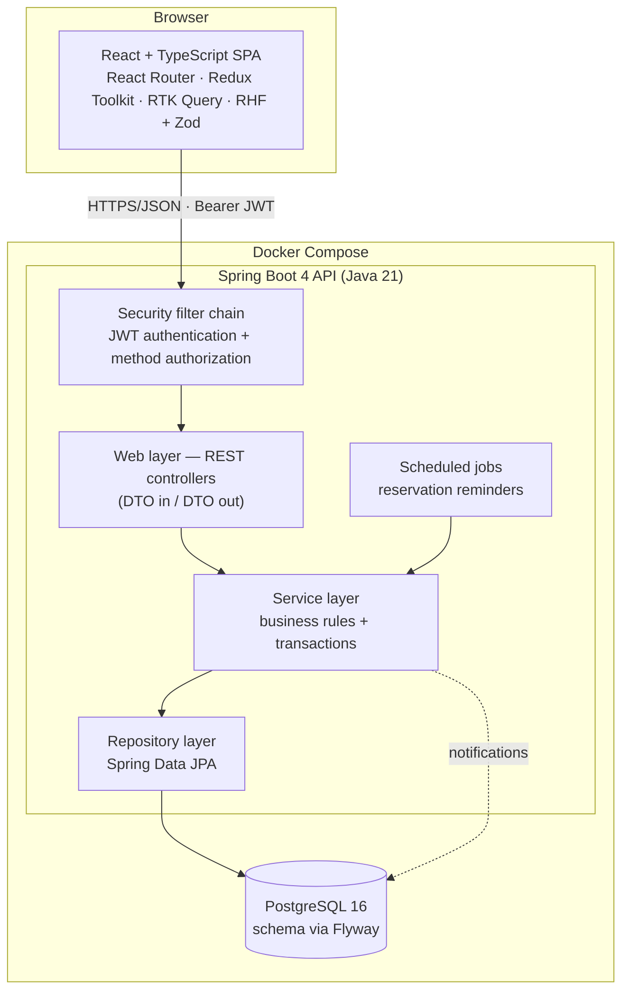

# Architecture — FacilityBook

## 1. System architecture



- The SPA talks to the API over JSON and sends the JWT in the `Authorization: Bearer`
  header.
- The API is stateless: every request is authenticated from its JWT; no server session is
  kept.
- All persistence goes through Spring Data JPA; the schema is owned by Flyway and Hibernate
  only validates it at startup.
- A scheduled component reuses the service layer to create reminder notifications.

## 2. Backend layering

```
com.groupthree.Facilitybook
├── config/        SecurityConfig, OpenApiConfig, CorsConfig, scheduling, app properties
├── web/           @RestController endpoints (one per resource), DTO in/out only
├── service/       Business rules, transaction boundaries, authorization decisions
├── repository/    Spring Data JPA interfaces + projections
├── entity/        JPA entities and enums
├── dto/           Request/response records (never expose entities)
├── security/      JwtService, JwtAuthenticationFilter, UserPrincipal, 401/403 handlers
├── exception/     Domain exceptions + GlobalExceptionHandler (consistent ApiError)
└── notification/  Notification types and scheduled reminder job
```

Request flow:

1. `JwtAuthenticationFilter` validates the token and populates the `SecurityContext`.
2. The controller receives a validated DTO and delegates to a service.
3. The service applies business rules inside a transaction, using the authenticated
   `UserPrincipal` for authorization.
4. The repository persists/reads through JPA.
5. The service maps entities to response DTOs; `GlobalExceptionHandler` turns exceptions
   into a consistent error body.

## 3. Key design decisions

| Decision | Rationale |
| --- | --- |
| **DTO-only APIs** | Persistence entities are never serialised; input/output contracts are explicit and stable. |
| **Approval policy on `resource_categories`** | Approval requirements are a property of a class of resources, so they are configured once per category (`requires_approval`, `approver_role_id`). |
| **PostgreSQL exclusion constraint for overlap** | Concurrency-safe by construction: `EXCLUDE USING gist (resource_id WITH =, tstzrange(start,end) WITH &&) WHERE status IN ('PENDING_APPROVAL','CONFIRMED')`. Check-then-insert cannot guarantee this under concurrency. |
| **Pessimistic row locks on mutation** | `findByIdForUpdate` serialises approve/cancel/reschedule/maintenance mutations on the same reservation, preventing lost updates and deadlock-prone interleavings. |
| **`saveAndFlush` on reservation insert** | Forces the constraint check inside the transaction so a losing concurrent insert fails the request instead of silently succeeding. |
| **Half-open time ranges** | `tstzrange` is `[start, end)`, so back-to-back bookings are allowed while genuine overlaps are rejected. |
| **`TIMESTAMPTZ` everywhere** | Consistent UTC storage; operating hours (local wall-clock) are interpreted in `APP_TIMEZONE` when validating and reporting. |
| **Stateless JWT security** | No server-side session; the identity is derived from the security context on every request, satisfying the brief's security reminder. |
| **Record-level authorization in services** | Ownership checks (own reservation, own department, own notifications) are enforced server-side, not by the UI. |
| **Scheduled reminder job with idempotency** | Reuses the existing `RESERVATION_REMINDER` notification row to avoid duplicates. |
| **Redux Toolkit + RTK Query (frontend)** | Shared/auth state and server cache are separated; local UI state (modals, form state) stays in `useState`/React Hook Form. |

## 4. Security model

- **Authentication:** `POST /api/auth/login` verifies the BCrypt password hash and issues
  an HS256 JWT containing the user id, email, role, and department.
- **Authorization — role based:** endpoint-level `@PreAuthorize` rules
  (e.g. `hasAnyRole('ADMIN','FACILITY_MANAGER')`).
- **Authorization — record level:** services compare the authenticated principal against
  the record (requester, department, approver role) and throw `403` on violation.
- **Self-approval guard:** an approver can never decide their own reservation.
- **Consistent errors:** 401 and 403 are returned as JSON `ApiError` bodies by dedicated
  authentication entry point and access-denied handlers.

Role → capability summary:

| Capability | ADMIN | EMPLOYEE | FACILITY_MANAGER | DEPARTMENT_MANAGER | RESOURCE_OPERATOR |
| --- | :-: | :-: | :-: | :-: | :-: |
| Browse/search resources | ✓ | ✓ | ✓ | ✓ | ✓ |
| Create/edit resources | ✓ | – | ✓ | – | – |
| Operating hours / status | ✓ | – | ✓ | – | ✓ |
| Create reservation | ✓ | ✓ | ✓ | ✓ | ✓ |
| View own reservations | ✓ | ✓ | ✓ | ✓ | ✓ |
| List all reservations | ✓ | – | ✓ | ✓ | ✓ |
| Report damage | ✓ | ✓ | ✓ | ✓ | ✓ |
| Schedule maintenance | ✓ | – | ✓ | – | ✓ |
| Approve reservations | ✓ | – | ✓ | ✓ | – |
| Reports | ✓ | – | ✓ | ✓ | ✓ |
| Manage users/roles | ✓ | – | – | – | – |

## 5. Deployment topology

`docker-compose.yml` defines two services:

- **`db`** — `postgres:16-alpine`, with a named volume `facilitybook-db-data` and a
  healthcheck. Host port `5433` (configurable) maps to container `5432`.
- **`app`** — built from a multi-stage `Dockerfile` (Maven build stage → JRE runtime
  stage), depends on `db` being healthy, and exposes host port `8080` (configurable).

Startup sequence: Postgres becomes healthy → the API starts → Flyway migrates the schema
and seeds demo data → the app serves traffic. A fresh clone can be started with
`docker compose up --build`.
