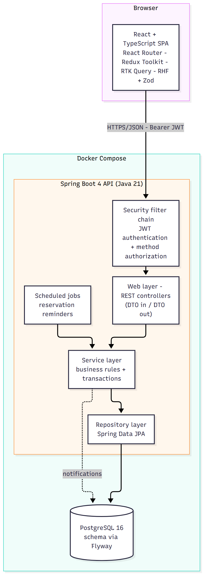
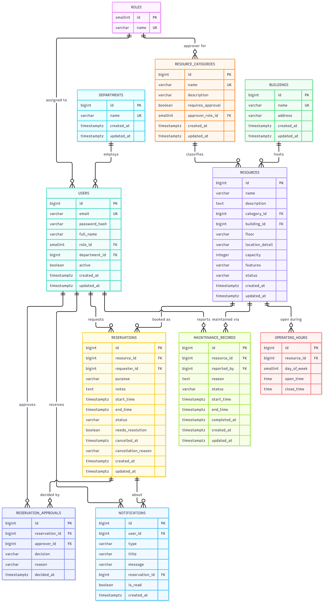

# FacilityBook — Project Report

**Project:** FacilityBook — Enterprise Facility & Resource Reservation System
**Team:** Group Three
**Document version:** 1.0
**Status:** Backend and database complete and verified; frontend integration in progress

---

## 1. Executive summary

FacilityBook is a web application that lets an organisation share and book its common
resources — meeting rooms, conference halls, training rooms, projectors, company vehicles,
and office equipment — without double-booking. Employees discover free resources and make
reservations; authorized staff manage resources, operating hours, approvals, maintenance,
and reporting.

The system is built as three tiers: a **React + TypeScript** single-page application, a
**Spring Boot 4** REST API secured with **JWT**, and a **PostgreSQL 16** database whose
schema is managed entirely through **Flyway** migrations. The complete backend and database
start with a single `docker compose up`.

The most important engineering guarantee is that **double-booking is impossible even under
concurrent requests**: overlapping reservations are rejected by a PostgreSQL exclusion
constraint, not by a check-then-insert in application code.

**Current status:** the backend and database are complete and verified — **33 automated
tests pass**, a **66-check end-to-end smoke script** passes against a fresh Docker stack,
and the API is documented with **Swagger/OpenAPI**. The frontend is being integrated.

---

## 2. What the project is about

### 2.1 The problem
In many organisations, shared resources are booked informally (whiteboards, spreadsheets,
email). This causes:

- two people reserving the same room at the same time;
- resources being unavailable without anyone knowing why;
- no visibility into how resources are actually used.

### 2.2 The solution
FacilityBook provides a single source of truth with rules enforced by the backend and the
database:

- **Discover** — search resources and see only those genuinely free for a chosen window.
- **Book** — create a reservation that is validated and protected against clashes.
- **Approve** — restricted resources (halls, vehicles) route to the right approver.
- **Maintain** — report damage, schedule downtime, and block affected periods.
- **Notify** — in-app notifications for confirmations, decisions, cancellations, reminders,
  and maintenance changes.
- **Report** — utilisation, department usage, peak times, and downtime.

### 2.3 User roles
| Role | Responsibilities |
| --- | --- |
| ADMIN | Manage users, roles, categories, buildings, departments; can act as any approver. |
| EMPLOYEE | Search resources, book, report damage, manage own bookings and notifications. |
| FACILITY_MANAGER | Manage facilities and availability, approve facility-routed reservations, schedule maintenance. |
| DEPARTMENT_MANAGER | Approve reservations routed to their department; view department reporting. |
| RESOURCE_OPERATOR | Manage resource schedules, availability, and maintenance. |

---

## 3. What we built

### 3.1 Functional modules

| Module | Delivered capabilities |
| --- | --- |
| **Resource management** | Register resources (name, description, category, building, floor, location, capacity, features, status); per-weekday operating hours; availability search. |
| **Reservation management** | Create/reschedule/cancel reservations; start-before-end, past-start, operating-hours, and maintenance validation; database-level overlap prevention; own history and upcoming bookings; staff-wide listing with filters. |
| **Approval workflow** | Configurable approval policy per resource category; automatic confirmation when no approval is needed; routing to the correct approver role; approve/reject with reason; approval history; self-approval blocked. |
| **Resource maintenance** | Employees report damaged/unavailable resources; staff schedule and progress maintenance; affected periods blocked; conflicting reservations flagged for resolution; completion restores service. |
| **Notifications** | Confirmation, approval/rejection, cancellation, upcoming reminder, and maintenance-change notifications; unread count; mark one/all read. |
| **Analytics & reporting** | Totals by status, most-reserved resources, utilisation vs. operating hours, pending approvals and cancellations, maintenance downtime, reservations by department and peak times. |

### 3.2 Engineering practices applied
- **Layered architecture:** controllers → services → repositories → entities, with separate
  DTOs and security configuration.
- **DTO-only APIs:** persistence entities are never exposed.
- **Backend validation + consistent errors:** every error returns the same `ApiError` shape
  (`timestamp, status, error, message, path`).
- **Role-based *and* record-level authorization**, both derived from the security context.
- **Meaningful relational constraints:** foreign keys, uniqueness, check constraints, and a
  GiST exclusion constraint.
- **Pagination, sorting, searching, and filtering** on list endpoints.
- **Automated tests** for business rules, authorization boundaries, and concurrency.
- **Environment variables for secrets**; only `.env.example` is committed.
- **One-command startup** with Docker Compose.

---

## 4. System architecture



The SPA talks JSON over HTTP to the API, sending the JWT in an `Authorization: Bearer`
header. The API is stateless: each request is authenticated from its token and the identity
is read from the security context. Persistence goes through Spring Data JPA, and the schema
is owned by Flyway (Hibernate runs in `validate` mode). A scheduled component reuses the
service layer to create reminder notifications.

Backend packages:

```
config/       Security, OpenAPI, CORS, scheduling, application properties
web/          REST controllers (DTO in / DTO out)
service/      Business rules and transaction boundaries
repository/   Spring Data JPA repositories and projections
entity/       JPA entities and enums
dto/          Request/response records
security/     JWT filter, principal, 401/403 handlers
exception/    Domain exceptions and global error handling
```

See [`ARCHITECTURE.md`](ARCHITECTURE.md) for the full design-decision rationale and the
role → capability matrix.

---

## 5. Data model (ERD)



Eleven domain tables are created by Flyway migrations `V1`–`V11` (seed data in `V12`–`V13`):

| Table | Purpose |
| --- | --- |
| `roles` | System roles. |
| `departments` | Organisation departments (approval routing and reporting). |
| `users` | Accounts with role and department references. |
| `buildings` | Buildings and locations. |
| `resource_categories` | Classification **and approval policy**. |
| `resources` | Reservable rooms, equipment, and vehicles. |
| `operating_hours` | One open/close window per resource per weekday. |
| `reservations` | Booking time range, requester, purpose, status. |
| `reservation_approvals` | Approval decisions with actor, time, and reason. |
| `maintenance_records` | Damage reports and scheduled downtime. |
| `notifications` | In-app notifications and read status. |

Key constraints:

- Foreign keys link users → roles/departments, resources → categories/buildings,
  reservations → resources/users, approvals → reservations/users, maintenance →
  resources/users, and notifications → users/reservations.
- Uniqueness on role/department/building/category names, user email, and
  `(resource_id, day_of_week)`.
- Check constraints enforce valid time ranges, valid statuses, positive capacity, and a
  configured approver whenever approval is required.

The full column list, relationship diagram, and constraint detail are in
[`ERD.md`](ERD.md).

### 5.1 How double-booking is prevented
```sql
CONSTRAINT no_overlapping_reservations
    EXCLUDE USING gist (
        resource_id WITH =,
        tstzrange(start_time, end_time) WITH &&
    )
    WHERE (status IN ('PENDING_APPROVAL', 'CONFIRMED'))
```
`tstzrange` is half-open `[start, end)`, so back-to-back bookings are allowed while real
overlaps are rejected. The `WHERE` clause means only active reservations participate.
Mutating operations also take a row lock (`findByIdForUpdate`), and inserts use
`saveAndFlush` so a losing concurrent request fails instead of silently succeeding.

---

## 6. API surface

Base URL: `http://localhost:8080/api`. Swagger UI: `/swagger-ui.html`; OpenAPI JSON:
`/v3/api-docs`. Authenticate at `POST /api/auth/login` and send the returned
`accessToken` as a bearer token.

| Method | Path | Access |
| --- | --- | --- |
| POST | `/auth/login` | Public |
| GET | `/auth/me` | Authenticated |
| GET | `/resources` | Authenticated |
| GET | `/resources/available` | Authenticated |
| GET | `/resources/{id}` | Authenticated |
| POST / PUT / DELETE | `/resources`, `/resources/{id}` | ADMIN, FACILITY_MANAGER |
| PATCH | `/resources/{id}/status` | ADMIN, FACILITY_MANAGER, RESOURCE_OPERATOR |
| GET | `/resources/{id}/operating-hours` | Authenticated |
| PUT | `/resources/{id}/operating-hours` | ADMIN, FACILITY_MANAGER, RESOURCE_OPERATOR |
| POST | `/reservations` | Authenticated |
| GET | `/reservations/mine` | Authenticated |
| GET | `/reservations` | Staff (ADMIN, FM, DM, RO) |
| GET | `/reservations/{id}` | Owner or staff |
| GET | `/reservations/{id}/approvals` | Owner or staff |
| PATCH | `/reservations/{id}/reschedule` | Owner or staff |
| PATCH | `/reservations/{id}/cancel` | Owner or staff |
| PATCH | `/reservations/{id}/resolve-conflict` | ADMIN, FACILITY_MANAGER, RESOURCE_OPERATOR |
| GET | `/approvals/pending` | ADMIN, FACILITY_MANAGER, DEPARTMENT_MANAGER |
| POST | `/approvals/{reservationId}/decision` | ADMIN, FACILITY_MANAGER, DEPARTMENT_MANAGER |
| GET | `/maintenance`, `/maintenance/{id}` | ADMIN, FACILITY_MANAGER, RESOURCE_OPERATOR |
| POST | `/maintenance` | Authenticated (report = REPORTED; schedule = staff) |
| PATCH | `/maintenance/{id}` | ADMIN, FACILITY_MANAGER, RESOURCE_OPERATOR |
| GET | `/notifications`, `/notifications/unread-count` | Authenticated (own) |
| PATCH | `/notifications/{id}/read` | Authenticated (own) |
| POST | `/notifications/read-all` | Authenticated (own) |
| GET | `/reports/summary`, `/resources`, `/departments`, `/peak-times` | ADMIN, FM, DM, RO |
| GET/POST/PUT | `/users`, `/users/{id}` | ADMIN |
| GET | `/users/roles` | ADMIN |
| GET/POST/PUT/DELETE | `/buildings`, `/departments`, `/resource-categories` | See docs |

---

## 7. Security and authorization

- **Authentication:** BCrypt password verification, HS256 JWT containing user id, email,
  role, and department.
- **Role-based authorization:** endpoint-level `@PreAuthorize` rules.
- **Record-level authorization:** services compare the authenticated principal against the
  record (requester, department, approver role) and reject violations.
- **Self-approval guard:** an approver can never decide their own reservation.
- **Consistent error contract:** dedicated 401/403 handlers return JSON `ApiError` bodies.

The frontend hides controls by role for usability, but **every permission is enforced by
the backend** — the UI is never trusted.

---

## 8. Technology stack

| Layer | Technologies |
| --- | --- |
| Frontend | React 19 + TypeScript, React Router, Redux Toolkit, RTK Query, React Hook Form, Zod, Axios, Vite |
| Backend | Java 21, Spring Boot 4, Spring Web, Spring Data JPA, Spring Security, JWT (jjwt) |
| Database | PostgreSQL 16, Flyway migrations |
| API docs | springdoc-openapi (Swagger UI / OpenAPI 3.1) |
| Testing | JUnit 5, Mockito, Testcontainers; Vitest, React Testing Library |
| Infrastructure | Docker, Docker Compose, Maven, Node.js |

---

## 9. Testing and results

| Suite | Result |
| --- | --- |
| Backend (`mvn -B clean test`) | **33 tests, 0 failures** |
| Frontend (`npm test`) | **17 tests, 0 failures** |
| End-to-end smoke (live Docker stack) | **66/66 checks pass** |

Highlights:

- **Concurrency:** `ReservationConcurrencyTest` proves that of two simultaneous overlapping
  bookings exactly one succeeds, and that the database exclusion constraint rejects a
  direct overlapping insert.
- **Authorization:** `SecurityAuthorizationTest` verifies JSON 401s, employee 403
  boundaries, employee damage-report vs. staff scheduling, reports/user-management
  boundaries, and record-level reservation access.
- **Business rules:** service unit suites cover reservation rules, the approval workflow,
  maintenance transitions and conflict flagging, and report utilisation.

The full inventory is in [`TEST_REPORT.md`](TEST_REPORT.md).

---

## 10. Deployment and how to run

```bash
# Start the whole backend stack (Postgres + API)
docker compose up --build -d

# API:      http://localhost:8080/api
# Swagger:  http://localhost:8080/swagger-ui.html
# Health:   http://localhost:8080/actuator/health

# Fresh database (re-runs migrations + demo seed)
docker compose down -v && docker compose up -d
```

Demo accounts (password `Password123!`): `admin@`, `employee@`, `facility@`,
`deptmanager@`, `operator@` — all at `@facilitybook.local`. Details, environment
variables, and the frontend setup are in the [README](../README.md).

---

## 11. What we did (process)

1. **Analysis and design** — studied the brief, defined scope and use cases, designed the
   ERD and architecture, and set up the React/Spring Boot skeleton with PostgreSQL and
   Docker.
2. **Backend** — implemented entities, repositories, services, REST APIs, validation,
   exception handling, JWT authentication, and role/record-level authorization; added
   Flyway migrations table by table.
3. **Concurrency** — chose a PostgreSQL exclusion constraint over application-level
   checks, added row locks for mutations, and proved the behaviour with tests.
4. **Maintenance and reporting** — added damage reporting, scheduled downtime with
   conflict flagging, in-app notifications with a reminder job, and analytics.
5. **Testing and hardening** — built unit and Testcontainers integration suites plus an
   end-to-end smoke script; fixed edge cases (unknown sort properties, terminal
   maintenance transitions, stale conflict flags).
6. **Documentation and delivery** — produced the SRS, ERD, use cases, architecture, user
   guide, and test report; verified a clean Docker Compose startup.

---

## 12. Deliverables checklist

| # | Deliverable | Status |
| --- | --- | --- |
| 1 | Git repository with clear commit history | ✅ |
| 2 | Functional React frontend + Spring Boot backend | Backend ✅ / frontend in progress |
| 3 | PostgreSQL schema via Flyway | ✅ |
| 4 | Docker Compose for the complete application | ✅ |
| 5 | SRS document | ✅ `docs/SRS.md` |
| 6 | ERD and use-case diagram | ✅ `docs/ERD.md`, `docs/USE_CASES.md`, `docs/diagrams/` |
| 7 | Architecture diagram | ✅ `docs/ARCHITECTURE.md` |
| 8 | Swagger/OpenAPI documentation | ✅ `/swagger-ui.html` |
| 9 | Automated tests and test report | ✅ `docs/TEST_REPORT.md` |
| 10 | README (prereqs, env, setup, demo accounts, API URL, screenshots, limitations) | ✅ `README.md` |
| 11 | User guide | ✅ `docs/USER_GUIDE.md` |
| 12 | Individual contribution report | ✅ template `docs/CONTRIBUTION_REPORT.md` |

---

## 13. Known limitations and future work

- In-app notifications only (no email/WebSocket); multi-timezone not supported; operating
  hours are simple daily windows; one approval decision per reservation; no recurring
  bookings; text-only damage reports.
- Future enhancements: email/WebSocket notifications, split-shift and date-exception
  operating hours, recurring reservations, attachments on maintenance reports, and a
  calendar view.

The full list is in the [README](../README.md#9-known-limitations).

---

## 14. Related documents

| Document | Contents |
| --- | --- |
| [`SRS.md`](SRS.md) | Requirements specification. |
| [`ERD.md`](ERD.md) | Data model and constraints. |
| [`USE_CASES.md`](USE_CASES.md) | Use-case diagram and descriptions. |
| [`ARCHITECTURE.md`](ARCHITECTURE.md) | Architecture and design decisions. |
| [`USER_GUIDE.md`](USER_GUIDE.md) | Role-by-role walkthrough. |
| [`TEST_REPORT.md`](TEST_REPORT.md) | Test inventory and results. |
| [`CONTRIBUTION_REPORT.md`](CONTRIBUTION_REPORT.md) | Per-intern contributions. |
| [`diagrams/`](diagrams/) | Mermaid sources and rendered diagrams. |
