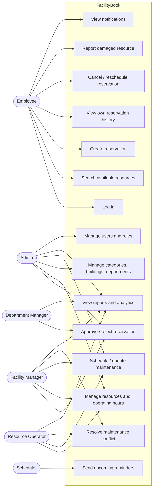

# Use Cases — FacilityBook

## 1. Actors

| Actor | Description |
| --- | --- |
| **Employee** | Any staff member who books resources and manages their own bookings. |
| **Facility Manager** | Manages facilities and availability, approves facility-routed reservations, schedules maintenance. |
| **Department Manager** | Approves reservations routed to their department. |
| **Resource Operator** | Manages operating schedules and maintenance. |
| **Admin** | Manages users, roles, categories, buildings, departments; can act as any approver. |
| **Scheduler (system)** | Background job that creates upcoming-reservation reminders. |

All staff actors inherit the Employee capabilities.

## 2. Use-case diagram

## 3. Detailed use cases

### UC-01 Log in
- **Actor:** All.
- **Precondition:** A user account exists.
- **Main flow:** User submits email + password → backend verifies credentials → returns a
  JWT and the user's profile (role, department) → frontend stores the session and shows a
  role-aware navigation menu.
- **Alternate flow:** Invalid credentials → `401` with a consistent `ApiError`.
- **Postcondition:** The user is authenticated; subsequent requests carry the JWT.

### UC-02 Search available resources
- **Actor:** Employee (and all staff).
- **Main flow:** User selects a date and time window and optional filters (category,
  building, capacity) → backend returns only resources that are active, have no
  overlapping active reservation, are not under maintenance in the window, and whose
  operating hours cover the whole window.
- **Alternate flow:** No matches → empty result; the UI shows an empty state.
- **Postcondition:** The user can pick a resource to book.

### UC-03 Create reservation
- **Actor:** Employee.
- **Precondition:** A suitable resource exists.
- **Main flow:** User enters resource, start, end, purpose → backend validates the range,
  operating hours, and maintenance windows, and attempts to insert → if the category does
  not require approval the reservation is `CONFIRMED`; otherwise it is `PENDING_APPROVAL`
  and the correct approvers are notified.
- **Alternate flows:**
  - Invalid range or outside operating hours → `400`.
  - Overlaps an existing reservation or maintenance window → `409`.
  - Concurrent identical request → only one succeeds (database exclusion constraint).
- **Postcondition:** A reservation row exists; the requester is notified.

### UC-04 View own reservation history
- **Actor:** Employee.
- **Main flow:** User opens "My reservations" → backend returns only the caller's
  reservations, paginated and filterable by status, sorted by start time.
- **Security:** Record-level authorization — a user cannot read another user's
  reservation (`403`).
- **Postcondition:** The user sees current and past bookings.

### UC-05 Cancel / reschedule reservation
- **Actor:** Employee (own bookings); staff (any booking).
- **Main flow (cancel):** User cancels → backend checks ownership/policy, sets status
  `CANCELLED`, records the time and optional reason, notifies affected parties.
- **Main flow (reschedule):** User supplies a new window → backend re-runs all validation;
  if the reservation required approval it returns to `PENDING_APPROVAL`.
- **Alternate flow:** Another employee tries to cancel someone else's reservation → `403`.
- **Postcondition:** The calendar reflects the change; notifications are created.

### UC-06 Report damaged resource
- **Actor:** Employee.
- **Main flow:** User submits a maintenance report for a resource with a reason and
  period → record is created in status `REPORTED` for staff to triage.
- **Alternate flow:** An employee tries to pre-schedule maintenance as `SCHEDULED` → `403`.
- **Postcondition:** Staff can see and act on the report.

### UC-07 View notifications
- **Actor:** Employee (and all staff).
- **Main flow:** User lists notifications, sees the unread count, marks one or all as read.
- **Postcondition:** Read state is persisted.

### UC-08 Approve / reject reservation
- **Actor:** Facility Manager, Department Manager, Admin.
- **Precondition:** A `PENDING_APPROVAL` reservation is routed to the actor.
- **Main flow:** Approver opens the queue → decides approve or reject (reason required for
  reject) → backend verifies the actor's role matches the category policy and that the
  actor is not the requester → status becomes `CONFIRMED` or `REJECTED`; an approval row
  is stored; the requester is notified.
- **Alternate flows:**
  - Wrong role for the category → `403`.
  - Department manager acting outside their department → `403`.
  - Approver is the requester (self-approval) → `403`.
  - Maintenance now overlaps the reservation → `409`.
- **Postcondition:** Approval history records the decision.

### UC-09 Manage resources and operating hours
- **Actor:** Admin, Facility Manager (create/edit resources); also Resource Operator for
  hours/status.
- **Main flow:** Create or edit a resource; define operating hours (one window per
  weekday); change status.
- **Alternate flow:** An employee tries to create a resource → `403`.
- **Postcondition:** The catalogue and availability rules are updated.

### UC-10 Manage reference data
- **Actor:** Admin.
- **Main flow:** Manage resource categories (including the approval policy), buildings,
  and departments.
- **Postcondition:** Reference data is updated and reflected in resource configuration.

### UC-11 Schedule / update maintenance
- **Actor:** Facility Manager, Resource Operator, Admin.
- **Main flow:** Staff schedules maintenance with a period and reason → backend flags any
  overlapping active reservations for resolution and blocks new bookings in the period →
  status progresses `SCHEDULED → IN_PROGRESS → COMPLETED`.
- **Postcondition:** The resource is unavailable for the period; conflicts are flagged.

### UC-12 Resolve maintenance conflict
- **Actor:** Facility Manager, Resource Operator, Admin.
- **Precondition:** A reservation is flagged `needsResolution`.
- **Main flow:** Staff cancels the conflicting reservation → the flag is cleared and the
  requester is notified.
- **Postcondition:** No reservation overlaps an active maintenance window.

### UC-13 View reports and analytics
- **Actor:** Admin, Facility Manager, Department Manager, Resource Operator.
- **Main flow:** User selects a period → backend returns a summary (totals by status,
  active resources, booked hours, maintenance downtime), top resources, utilization rates
  (against operating hours, capped at 100%), department usage, and peak times.
- **Alternate flow:** An employee requests reports → `403`.
- **Postcondition:** Reports are displayed.

### UC-14 Manage users and roles
- **Actor:** Admin.
- **Main flow:** List users (paginated/searchable), create a user, update a user, list
  roles.
- **Alternate flow:** Non-admin tries to list users → `403`.
- **Postcondition:** Accounts and role assignments are updated.

### UC-15 Send upcoming reminders
- **Actor:** Scheduler (system).
- **Main flow:** On a fixed interval, the job finds confirmed reservations starting within
  the configured horizon and creates at most one `RESERVATION_REMINDER` notification per
  reservation.
- **Postcondition:** Users are reminded of upcoming bookings.
